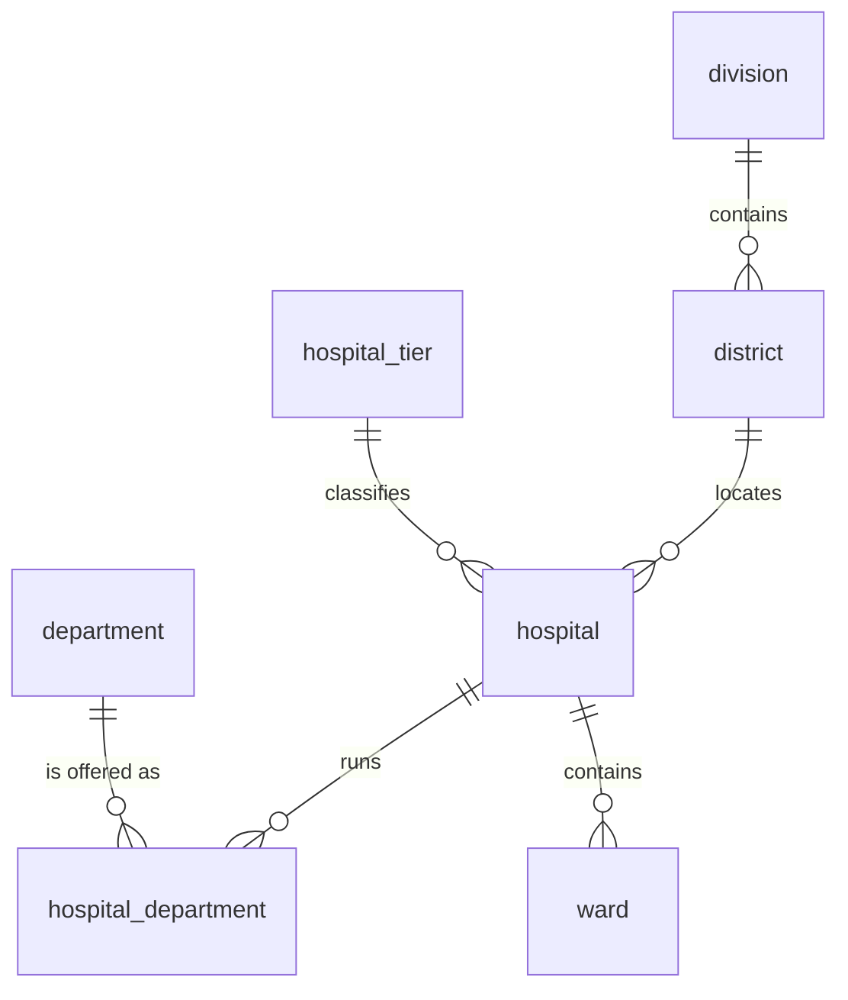
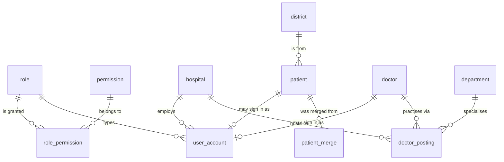
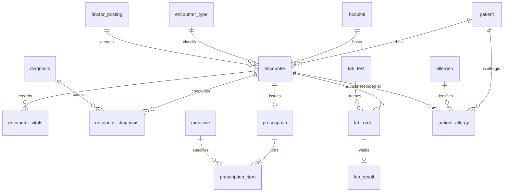
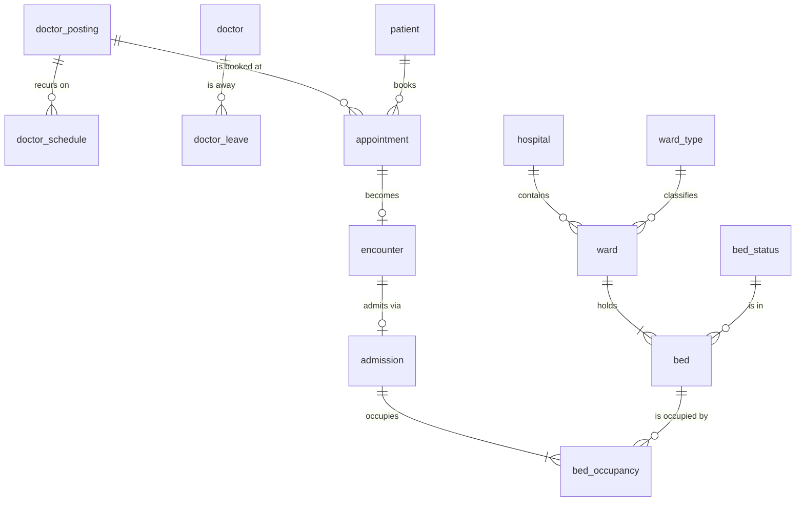
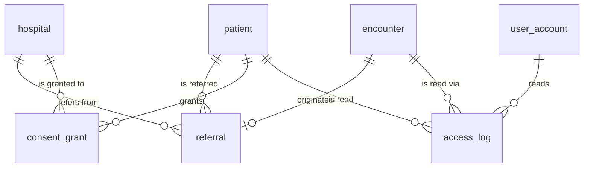

# ER design — UHID National Hospital Management System

Nobo Ishraque · Dept. of ICT, Bangladesh University of Professionals
Written 27 September 2026 · **Status: agreed. The five open questions were answered by the author on
27 September 2026 and are recorded as decisions in §8.**

This is the conceptual model: entities, their attributes, their keys, and the relationships
between them with cardinality and participation. It is the document `schema.sql`, the data
dictionary and the normalization write-up are all derived from, and it is the document to
revise if any of them disagrees with it.

It is written to be defended out loud. Every non-obvious choice has a *why* next to it,
because the viva asks "why did you model it that way", not "what tables do you have".

---

## 1. What this model has to prove

The project scores on seven decisions. The model exists to make each of them structurally
true — enforced by the database, not by hope and application code.

| # | Decision | The structures that carry it |
|---|---|---|
| 1 | UHID is anchored to a national ID; one human must not get two UHIDs | `patient.nid` UNIQUE-when-present, the duplicate-candidate query over (nid), (name, dob), (phone), and `patient_merge` for when prevention has already failed |
| 2 | Access is granted, not assumed | `role` / `permission` / `role_permission`, `consent_grant` with an expiry, `access_log` with a `basis` that includes break-glass, written on every clinical read (see §4.5 on how, given MySQL has no `SELECT` trigger) |
| 3 | Doctor availability is computed, never stored | `doctor_schedule` (recurring) − `doctor_leave` (exceptions) − `appointment` (taken). **There is deliberately no `slot` table.** |
| 4 | Booking is transactional | `UNIQUE(doctor_id, slot_start)` on `appointment`, plus `book_appointment()` using `SELECT … FOR UPDATE` |
| 5 | `encounter` is the clinical hub | `encounter_diagnosis`, `prescription` → `prescription_item`, `lab_order` → `lab_result`, `encounter_vitals` all hang off `encounter`; each references a catalogue, never free text |
| 6 | Referrals are what make it national | `referral` spans two hospitals and links the sending encounter to the receiving one |
| 7 | Bed state changes via trigger | `bed_occupancy` rows opened and closed by admission / transfer / discharge; a trigger on that table maintains `bed.status` |

If a change to this model would weaken one of those seven, the change is wrong.

---

## 2. Scope boundary

Modelled: registration and identity, the clinical record, appointments and availability,
inpatient beds, referrals, consent and audit.

**Deliberately not modelled** — named here so the omissions read as decisions rather than gaps:

- **Billing, payments, insurance.** `doctor_posting.fee` is displayed on the booking screen;
  no invoice, ledger or payment entity exists. Billing is a whole second system.
- **Pharmacy stock and dispensing.** A prescription is written; nobody counts inventory.
- **Imaging.** `lab_order` covers ordered investigations. Storing images is a PACS problem.
- **Staff HR** — payroll, nurse rosters, leave approval chains. Only clinical scheduling is
  modelled, and only for doctors.
- **Bengali-language content.** One name column per entity, `utf8mb4`, so Bangla *fits*; no
  parallel translated columns.
- **Upazila.** Geography stops at district (§8, decision 4). The administrative hierarchy is
  really division → district → upazila, and an upazila-level facility such as "Upazila Health
  Complex, Savar" therefore resolves only as far as district Dhaka. A stated simplification,
  not an oversight: one table and one FK would fix it if the write-up ever needs sub-district
  reporting.

---

## 3. Conventions

- **MySQL 8, InnoDB, `utf8mb4` / `utf8mb4_0900_ai_ci`.** Bangla names and `৳` must store
  correctly, and InnoDB is required for foreign keys, transactions and `SELECT … FOR UPDATE`.
- **Table names: singular, `snake_case`** (`patient`, not `patients`). A row is one patient.
- **Surrogate integer primary keys** named `<table>_id`, `AUTO_INCREMENT`, except where a weak
  entity is better identified by its parent plus a discriminator (§6.1).
- **Timestamps: `DATETIME`, named `*_at`.** Every table that records an event also records the
  account that caused it.
- **Small closed value sets get a lookup table, not `ENUM`** — `hospital_tier`,
  `encounter_type`, `bed_status`. A lookup table can be extended by an `INSERT`; extending an
  `ENUM` is an `ALTER TABLE` on a live table, and an `ENUM` cannot be the target of a foreign
  key. The exception is a set genuinely fixed by something outside the system (`sex`,
  `severity`), where `ENUM` is honest.
- **No column is nullable unless the null carries meaning**, and where it does, this document
  says what the null means (e.g. `admission.discharged_at IS NULL` *is* the definition of a
  current inpatient).

---

## 4. The entities, in five clusters

Five diagrams rather than one, because one diagram with thirty entities is unreadable and
earns a question about legibility instead of a question about modelling. The formal submitted
ER diagram is drawn from these.

### 4.1 Institutions and geography



| Entity | Purpose | Primary key | Notable attributes |
|---|---|---|---|
| `division` | The 8 divisions of Bangladesh | `division_id` | `name` UNIQUE |
| `district` | The 64 districts | `district_id` | `name`, `division_id` FK |
| `hospital_tier` | Medical College / District / Upazila / Specialised / Private | `tier_id` | `name` UNIQUE |
| `hospital` | A connected facility | `hospital_id` | `name`, `district_id`, `tier_id`, `address`, `phone`, `is_active` |
| `department` | The **national** catalogue of specialities — Cardiology, Nephrology, … | `department_id` | `name` UNIQUE |
| `hospital_department` | Which hospital actually offers which speciality | `hospital_id`, `department_id` | `head_doctor_id` nullable, `opd_room` |

**Why `department` is national and `hospital_department` resolves it.** Cardiology at Dhaka
Medical and Cardiology at Square are the same speciality, and a national doctor search has to
be able to say "Cardiology anywhere". If each hospital owned its own department rows, the
string "Cardiology" would exist eight times over and the search would be a `LIKE` across free
text. So the speciality is a catalogue entity, and hospital-to-speciality is a many-to-many
relationship with its own attributes.

### 4.2 People, identity and access



| Entity | Purpose | Primary key | Notable attributes |
|---|---|---|---|
| `role` | Patient · Receptionist · Doctor · Hospital Admin · System Admin · Lab Technician | `role_id` | `code` UNIQUE, `label` |
| `permission` | One capability — `patient.read_clinical`, `bed.admit`, `encounter.write` | `permission_id` | `code` UNIQUE, `description` |
| `role_permission` | Which role may do what | `role_id`, `permission_id` | — |
| `user_account` | A login | `account_id` | `username` UNIQUE, `password_hash`, `role_id`, `hospital_id` nullable, `patient_id` nullable **UNIQUE**, `doctor_id` nullable **UNIQUE**, `is_active`, `last_login_at` |
| `patient` | A human with a UHID | `patient_id` | `uhid` UNIQUE, `name`, `dob`, `sex`, `blood_group`, `phone`, `nid`, `district_id`, `address`, `kin_name`, `kin_relation`, `kin_phone`, `registered_at`, `registered_hospital_id`, `identity_verified`, `verified_by`, `verified_at` |
| `patient_merge` | Records that two UHIDs were one human | `merge_id` | `losing_patient_id`, `surviving_patient_id`, `merged_at`, `merged_by`, `reason` |
| `doctor` | A registered practitioner | `doctor_id` | `name`, `bmdc_reg` UNIQUE, `qualifications`, `is_active` |
| `doctor_posting` | This doctor, at this hospital, in this speciality, for this fee | `posting_id` | `doctor_id`, `hospital_id`, `department_id`, `consultation_fee`, `valid_from`, `valid_to` nullable |

#### Why `patient_id` is a surrogate key and `uhid` is only UNIQUE

The UHID is the natural key — unique by construction, printed on the card, and
`BD-2026-13052-1` means something to a human in a way that `47` does not. It is still not the
primary key, for two reasons:

1. **Foreign-key width.** `uhid` is `CHAR(15)` (`BD-2026-13052-1` is fifteen characters). It would be the foreign key in `encounter`,
   `appointment`, `admission`, `consent_grant`, `access_log` and `patient_allergy` — the
   largest tables in the system. A 4-byte `INT` in each of those, and in every index over
   them, is materially smaller and faster to join.
2. **Merging.** Decision 1 is that one human must not hold two UHIDs, and `js/seed.js` ships
   two rows that are deliberately the same man — `BD-2019-04821-7` and `BD-2018-00723-1`, same
   name, same date of birth, the second registered with no NID. Prevention is the goal; a
   merge path is the admission that prevention sometimes arrives too late. With a surrogate
   key, the merge repoints child rows to the surviving `patient_id` and retires the losing row
   while **keeping its UHID resolvable** — a patient holding the old card is still found. If
   the UHID were the primary key, the merge would rewrite the key column of every clinical row
   the patient has, which is precisely the operation you do not want to perform on a medical
   history.

`uhid` is therefore `CHAR(15) NOT NULL UNIQUE` with a `CHECK` on its format:
`BD-<year>-<5-digit serial>-<check digit>`, the check digit being the serial's digits summed
mod 10. Issuing is a stored procedure, not application code, so the serial comes from one
place under one lock.

> **Known defect, already logged.** The five patients in `js/seed.js` have check digits that
> fail this rule (`0+4+8+2+1 = 15`, so `BD-2019-04821-…` must end in `5`, not `7`). Seeding
> from those values imports the bug into MySQL, where the `CHECK` constraint will reject them.
> Corrected digits are in **Open items** in `CLAUDE.md`. Fix `js/seed.js` before writing
> `database/seed.sql`.

#### Why `doctor_posting` exists instead of `doctor.hospital_id`

`js/data.js` gives each doctor a single `hospitalId`. That is a simplification the real domain
does not support: a Bangladeshi consultant typically holds a government post *and* sees private
patients elsewhere, and the fee differs by place. Modelling it as a one-to-many
`hospital → doctor` relationship forces a choice between duplicating the doctor row per
hospital — which breaks BMDC uniqueness and splits their appointment history — or losing the
second practice entirely.

So `doctor_posting` is an associative entity with its own attributes. Department and fee live
on the *posting*, not on the doctor, because they genuinely vary by place.

**The frontend contract survives this.** `GET /api/doctors` returns one row per posting, so
`{ id, name, dept, qual, hospitalId, fee, bmdc }` still arrives exactly as `js/data.js` and
`pages/book.js` expect — a booking is always "this doctor, at this hospital", which is a
posting. The only change is that `id` becomes the posting id while `bmdc` stays the
practitioner's. No rendering code changes.

#### `user_account` and the three optional links

One login table for all six roles, with `patient_id`, `doctor_id` and `hospital_id` all
nullable, because which of them applies is determined by the role:

| Role | `hospital_id` | `patient_id` | `doctor_id` |
|---|---|---|---|
| Patient | null | set | null |
| Doctor | set | null | set |
| Receptionist · Hospital Admin · Lab Technician | set | null | null |
| System Admin | null | null | null |

The alternative — a supertype `person` with a subtype table per role, i.e. full
generalization/specialization — is the textbook answer and is rejected on purpose: it turns
every login into a join across three tables to answer "who is this and what may they do", and
the subtypes share almost no attributes. The nullable-FK form is enforced by the database rather
than by convention — but **not by a `CHECK`**, which is what an earlier draft of this document
claimed. A MySQL `CHECK` may not contain a subquery or reference another table, and the pattern
above is stated in terms of `role.code`, which lives in `role`. So it is a `BEFORE INSERT` /
`BEFORE UPDATE` trigger that looks up the role and raises `SIGNAL SQLSTATE '45000'`. Correcting
this mattered: "there is a CHECK constraint" would have been a wrong answer given confidently
in the viva.

**At most one login per person** (§8, decision 3), enforced by `UNIQUE` on `patient_id` and on
`doctor_id`. This works because MySQL permits any number of `NULL`s in a unique index, which is
exactly the wanted behaviour: every receptionist row has both columns null and does not
collide, while a patient cannot be given a second account by accident. A patient who needs a
carer to act for them therefore needs a delegate relationship rather than a shared password —
out of scope, and worth saying so if asked.

Passwords are bcrypt hashes verified **on the server**. `ACCOUNTS` in `js/data.js` is a
prototype stand-in holding plaintext demo passwords in readable JavaScript, and the write-up
should say so rather than hope nobody opens the file.

### 4.3 The clinical spine



| Entity | Purpose | Primary key | Notable attributes |
|---|---|---|---|
| `encounter_type` | OPD · Emergency · Inpatient | `type_id` | `code` UNIQUE, `label` |
| `encounter` | **The hub.** One clinical contact | `encounter_id` | `patient_id`, `hospital_id`, `type_id`, `posting_id`, `department_id`, `consultation_fee`, `started_at`, `ended_at` nullable, `chief_complaint`, `notes`, `created_by` |
| `encounter_vitals` | One set of observations at a moment | `encounter_id`, `recorded_at` | `bp_systolic`, `bp_diastolic`, `pulse`, `temp_c`, `spo2`, `weight_kg`, `height_cm`, `recorded_by` |
| `diagnosis` | Catalogue — ICD-10 code and term | `diagnosis_id` | `icd10_code` UNIQUE, `term`, `category` |
| `encounter_diagnosis` | What was concluded | `encounter_id`, `diagnosis_id` | `is_primary`, `certainty` (provisional/confirmed), `note` |
| `medicine` | Catalogue — generic, form, strength | `medicine_id` | `generic_name`, `brand_name`, `form`, `strength`, UNIQUE(`generic_name`,`form`,`strength`) |
| `prescription` | The header of one prescription | `prescription_id` | `encounter_id` UNIQUE, `prescribed_by`, `prescribed_at`, `advice`, `amended_at` nullable, `amended_by` nullable |
| `prescription_item` | One drug line | `prescription_id`, `line_no` | `medicine_id`, `dose`, `frequency`, `duration_days`, `instruction` |
| `lab_test` | Catalogue — name, specimen, reference range | `test_id` | `name` UNIQUE, `specimen`, `unit`, `ref_low`, `ref_high` |
| `lab_order` | An investigation ordered | `order_id` | `encounter_id`, `test_id`, `ordered_by`, `ordered_at`, `status` (ordered/collected/reported/cancelled) |
| `lab_result` | What came back | `order_id` | `value_num`, `value_text`, `is_abnormal`, `reported_by`, `reported_at` |
| `allergen` | Catalogue — substance or drug class | `allergen_id` | `name` UNIQUE, `class` |
| `patient_allergy` | A recorded allergy | `patient_id`, `allergen_id` | `severity` (Mild/Moderate/Severe), `note`, `first_recorded_encounter_id`, `recorded_at` |

#### Two columns that exist only because of a decision in §8

`encounter.consultation_fee` is a **copy** of `doctor_posting.consultation_fee`, taken when the
encounter is created. It is redundant by definition, and it is there because a fee is not a
property of the doctor, it is a property of what happened: raising a consultant's fee from ৳800
to ৳1000 next year must not silently restate what a patient was charged in 2026. This is the
standard treatment of a price on a historical transaction — the same reason an invoice line
stores the price it was sold at rather than joining to the current price list. Application code
sets it once, at insert, and never updates it.

`prescription.encounter_id` stays `UNIQUE` — one prescription per visit (§8, decision 2). A doctor
who changes their mind edits the existing prescription rather than issuing a second one, so
`amended_at` / `amended_by` exist to make that edit visible. Without them an amendment is
indistinguishable from the original, which in a prescription is the one place that matters.

#### The catalogue rule — the difference between a database and a spreadsheet

`js/seed.js` stores clinical content as strings:

```js
dx: 'Essential hypertension — review',
rx: ['Amlodipine 5 mg — 1 tablet at night — 90 days']
```

Correct for a prototype, unacceptable as storage. Free text cannot answer "how many
hypertensive patients are there", because the same condition will be typed `Essential
hypertension`, `HTN`, `hypertension (essential)` and `high BP`. Worse, the check that decision
1 exists to protect — *this patient reacted to Penicillin, do not prescribe it* — cannot fire
if the allergy holds the string `Penicillin` and the prescription holds the string
`Amoxicillin` as two unrelated pieces of text.

So `dx` becomes a foreign key to `diagnosis`, and each `rx` string decomposes into
`prescription_item.medicine_id` plus dose, frequency and duration as separate columns. Free
text survives only where it is genuinely narrative and never queried: `encounter.notes`,
`prescription.advice`, `patient_allergy.note`. That split — coded where it is queried, free
where it is prose — is the answer to give when asked why the schema is worth having at all.

#### The nested JSON is a projection of joins, not a storage shape

`patient.encounters[]`, `encounter.rx[]` and `patient.allergies[]` in the mock JSON are
repeating groups. They violate 1NF as stored data, and they are also exactly the right shape
for the record screen to render. Both are true, because the API composes them with joins at
read time:

| Mock JSON array | Stored as | Read back by |
|---|---|---|
| `patient.allergies[]` | `patient_allergy` → `allergen` | `GET /api/patients/:uhid` |
| `patient.encounters[]` | `encounter` filtered by `patient_id`, newest first | same |
| `encounter.rx[]` | `prescription` → `prescription_item` → `medicine` | same |
| `encounter.dx` | `encounter_diagnosis` → `diagnosis`, the `is_primary` row | same |

This is the sentence that joins the two halves of the project: **the frontend's shape is a
view, the database's shape is normalized, and the API is where one becomes the other.**
`public/` does not change in Week 4 because the JSON it receives does not change.

### 4.4 Scheduling and beds



| Entity | Purpose | Primary key | Notable attributes |
|---|---|---|---|
| `doctor_schedule` | A recurring weekly clinic | `schedule_id` | `posting_id`, `weekday` (0–6), `start_time`, `end_time`, `slot_minutes`, `valid_from`, `valid_to` nullable |
| `doctor_leave` | An exception that removes availability | `leave_id` | `doctor_id`, `from_at`, `to_at`, `reason` |
| `appointment` | A booked slot | `appointment_id` | `posting_id`, `doctor_id`, `patient_id`, `slot_start`, `slot_end`, `status` (booked/attended/cancelled/no_show), `booked_by`, `booked_at`, `encounter_id` nullable |
| `ward_type` | General · ICU · Paeds · Isolation | `ward_type_id` | `code` UNIQUE, `label` |
| `ward` | A ward in a hospital | `ward_id` | `hospital_id`, `name`, `ward_type_id`, `sex_restriction` nullable |
| `bed_status` | free · occupied · reserved · cleaning | `status_id` | `code` UNIQUE, `label` |
| `bed` | One bed | `ward_id`, `bed_no` | `status_id`, `is_out_of_service` |
| `admission` | An inpatient stay | `admission_id` | `encounter_id` UNIQUE, `admitted_at`, `admitted_by`, `discharged_at` nullable, `discharged_by` nullable, `discharge_summary`, `outcome` |
| `bed_occupancy` | Which bed, for which part of the stay | `occupancy_id` | `admission_id`, `ward_id`, `bed_no`, `from_at`, `to_at` nullable |

#### Availability is a query, not a table (decision 3)

There is no `slot` table, and that absence is the point. Materialising every 20-minute slot for
every doctor for the next 90 days is roughly 10 doctors × 30 slots × 90 days ≈ 27,000 rows
that are almost all empty, that go stale the moment a schedule changes, and that have to be
generated forward by a scheduled job forever.

Availability is derived instead, exactly as `pages/book.js` already describes it in prose:

```
available(posting, date) =
      slots generated from doctor_schedule for that weekday, stepped by slot_minutes
    − any slot overlapping a doctor_leave row for that doctor
    − any slot already in appointment with status = 'booked'
```

That is a recursive CTE over a date range joined against the two subtracting tables, served as
`GET /api/doctors/:postingId/availability?from=&to=`. It replaces `buildSlots()` in
`pages/book.js`, which currently hardcodes three days of times and a `taken` array.

Note `doctor_leave` hangs off `doctor_id`, not `posting_id`: a doctor on leave is away from
every hospital they practise at, not from one of them.

#### Why the unique constraint is on the doctor, not the posting (decision 4)

```sql
UNIQUE KEY uq_doctor_slot (doctor_id, slot_start)
```

`appointment` references `posting_id`, so the naive constraint would be
`UNIQUE(posting_id, slot_start)`. That is too weak: a doctor with a government post and a
private chamber could then be booked at 09:00 in both, and no human is in two hospitals at
once. The constraint therefore needs `doctor_id`, which is why `appointment` carries
`doctor_id` as a denormalized column — held correct by a composite foreign key
`(posting_id, doctor_id) → doctor_posting(posting_id, doctor_id)`. This is a deliberate,
constraint-enforced denormalization, and the one place in the model where a redundant column is
the right answer, because a `UNIQUE` index cannot span a join.

The constraint stops the double-booking; the stored procedure decides *who gets told what*:

```
book_appointment(posting_id, patient_id, slot_start):
  START TRANSACTION
  SELECT … FROM doctor_posting WHERE posting_id = ? FOR UPDATE   -- serialise on the doctor
  verify the slot is inside doctor_schedule and outside doctor_leave
  INSERT INTO appointment …                                      -- UNIQUE is the real guard
  COMMIT
```

Without `FOR UPDATE`, two concurrent bookings both pass the availability check and the loser
gets a duplicate-key error that reaches the user as a crash. With it, the second transaction
waits, re-reads, and the patient is told politely that the slot has gone.

#### Bed state, transfers, and the trigger (decision 7)

`admission` deliberately has no `bed_id`. A stay can move — General Medicine to ICU and back —
and a single `bed_id` on the admission would erase where the patient was yesterday. So the
stay is one `admission` row, and its bed history is one-or-more `bed_occupancy` rows with
exactly one open (`to_at IS NULL`) at any time.

That makes all three bed events the same operation on one table:

| Event | Operation on `bed_occupancy` |
|---|---|
| Admit | insert a row with `to_at = NULL` |
| Transfer | set `to_at` on the open row, insert a new open row |
| Discharge | set `to_at` on the open row, set `admission.discharged_at` |

One trigger on `bed_occupancy` maintains `bed.status` — `occupied` when a row opens, `cleaning`
then `free` when one closes. `bed.status` is therefore a **derived attribute stored for query
speed**, which is a normalization compromise made on purpose: the bed board in
`pages/wards.js` reads status for every bed on every render, and deriving it each time would
join the whole occupancy history. The trigger is what makes the redundancy safe — application
code never writes `bed.status`, so it cannot drift.

`pages/wards.js` already says exactly this in a comment and stands in for the trigger with
`localStorage`. Per the roles in `CLAUDE.md`, **the receptionist admits and the doctor
discharges**, which is a `role_permission` difference (`bed.admit` vs `bed.discharge`), not two
different tables.

`bed` is identified by `(ward_id, bed_no)` rather than by a surrogate `bed_id` — see §6.1.

### 4.5 Referral, consent and audit



| Entity | Purpose | Primary key | Notable attributes |
|---|---|---|---|
| `referral` | Hospital A sends a patient to Hospital B | `referral_id` | `patient_id`, `from_hospital_id`, `to_hospital_id`, `from_encounter_id`, `to_encounter_id` nullable, `reason`, `urgency` (routine/urgent/emergency), `referred_by`, `referred_at`, `status` (issued/arrived/completed/expired) |
| `consent_grant` | Permission to read a record | `grant_id` | `patient_id`, `to_hospital_id`, `to_doctor_id` nullable, `scope` (demographics/clinical/full), `granted_at`, `expires_at` (default `granted_at + INTERVAL 24 HOUR`), `revoked_at` nullable, `granted_via` (in_person/otp/referral) |
| `access_log` | Every clinical read, ever | `log_id` | `patient_id`, `account_id`, `hospital_id`, `encounter_id` nullable, `action`, `basis`, `is_break_glass`, `justification` nullable, `at`, `ip_address`, `reviewed_by` nullable, `reviewed_at` nullable |

#### Referral is what makes the system national (decision 6)

`to_encounter_id` is nullable, and the null is the whole mechanism. A referral is issued with
it empty; when the patient actually arrives at Hospital B and an encounter is created there,
it is filled in. So the null is what distinguishes *referred* from *arrived*, two encounters in
two different hospitals end up on one chain, and "patients referred to us who never turned up"
becomes a query rather than a phone call.

A referral also implies a consent grant — `consent_grant.granted_via = 'referral'` — because a
patient who agrees to be sent to Hospital B has agreed that Hospital B may read the record.
That is the seam between decisions 2 and 6.

#### A consent grant lasts 24 hours (§8, decision 5)

`expires_at` defaults to `granted_at + INTERVAL 24 HOUR`. Short by design: consent that does
not expire is not consent, it is a permanent handover, and a patient who visits one hospital
once should not still be readable there three years later.

The obvious objection is the inpatient who stays five days — does somebody wake them at 3 a.m.
on day two to re-consent? No, and the reason is that `consent_grant` is not the only lawful
`basis`. A clinician at the hospital of an **open encounter** reads under `basis = 'treating'`,
which lasts as long as the encounter rather than 24 hours. The grant exists for the harder
case: a hospital that wants the *national* history, from visits it had no part in. That is the
read worth putting a clock on.

#### `basis` is the column that makes the audit trail mean something (decision 2)

`ACCESS_LOG` in `js/data.js` already carries this idea, with `basis` values `Consent`,
`Break-glass — emergency` and `Demographics only`. Coded:

| `basis` | When it applies |
|---|---|
| `own_record` | A patient reading their own record |
| `treating` | Clinician at the hospital of an open encounter for this patient |
| `consent` | A live `consent_grant` covers this reader and this scope |
| `break_glass` | No grant existed; read anyway, `justification` required |
| `demographics_only` | Reception saw name, age, phone — no clinical content |

A log that records only *who read what* cannot distinguish legitimate care from snooping. One
that records *under what authority* can, and that is what makes break-glass acceptable rather
than a loophole: the access is allowed, it is flagged (`is_break_glass`), and the unreviewed
ones are a work queue (`reviewed_by IS NULL`).

**The one place this model has to be honest about a MySQL limitation.** MySQL has no `SELECT`
trigger, so "a trigger writes `access_log` on every clinical read" cannot be literally true.
The resolution: clinical reads go through a stored procedure that inserts the `access_log` row
and then returns the rows, and the application's database user is granted `EXECUTE` on that
procedure rather than `SELECT` on the clinical tables. The trigger that does exist fires
`AFTER INSERT` on `access_log` to flag break-glass rows for review. Decide the wording now and
put it in the write-up — this is the obvious question to be asked about decision 2, and
"a trigger does it" will not survive a follow-up.

---

## 5. Relationship summary with cardinality and participation

Read as **(min, max)** on each side. `(1,1)` is total participation — mandatory; `(0,n)` is
partial — optional.

| Relationship | Left | Right | Cardinality | Participation note |
|---|---|---|---|---|
| `district` locates `hospital` | (1,1) | (0,n) | 1 : N | Every hospital sits in a district |
| `hospital` runs `hospital_department` | (1,1) | (0,n) | M : N resolved | A hospital may run no departments yet |
| `doctor` practises via `doctor_posting` | (1,1) | (1,n) | M : N resolved | A doctor with no posting cannot be booked |
| `patient` has `encounter` | (1,1) | (0,n) | 1 : N | A registered patient may have no encounter yet |
| `encounter` concludes `encounter_diagnosis` | (1,1) | (0,n) | M : N resolved | An open encounter has no diagnosis yet |
| `encounter` issues `prescription` | (1,1) | (0,1) | 1 : 1 optional | Not every visit prescribes |
| `prescription` lists `prescription_item` | (1,1) | (1,n) | 1 : N total | A prescription with no drug is not a prescription |
| `encounter` orders `lab_order` | (1,1) | (0,n) | 1 : N | — |
| `lab_order` yields `lab_result` | (1,1) | (0,1) | 1 : 1 optional | Null until reported |
| `patient` is allergic `patient_allergy` | (1,1) | (0,n) | M : N resolved | — |
| `doctor_posting` recurs on `doctor_schedule` | (1,1) | (0,n) | 1 : N | A posting with no schedule is simply unbookable |
| `patient` books `appointment` | (1,1) | (0,n) | 1 : N | — |
| `appointment` becomes `encounter` | (0,1) | (0,1) | 1 : 1 optional | Null until attended; an encounter may be a walk-in |
| `ward` holds `bed` | (1,1) | (1,n) | 1 : N total | A ward with no beds is not a ward |
| `encounter` admits via `admission` | (1,1) | (0,1) | 1 : 1 optional | Only `Inpatient` encounters admit |
| `admission` occupies `bed_occupancy` | (1,1) | (1,n) | 1 : N total | Exactly one row open at a time |
| `patient` is referred `referral` | (1,1) | (0,n) | 1 : N | — |
| `patient` grants `consent_grant` | (1,1) | (0,n) | 1 : N | — |
| `user_account` reads `access_log` | (1,1) | (0,n) | 1 : N | Append-only — no update, no delete |

---

## 6. The modelling questions this will be asked

### 6.1 Weak entities

An entity is weak when it cannot be identified without its parent. Four here are, and are
given composite keys rather than surrogates to make that explicit:

| Weak entity | Identifying parent | Discriminator | Why weak |
|---|---|---|---|
| `bed` | `ward` | `bed_no` | "Bed 04" means nothing nationally. `GM-04` exists in every hospital; `(ward_id, 'GM-04')` is the identity |
| `prescription_item` | `prescription` | `line_no` | A drug line has no existence apart from its prescription, and deleting the prescription must delete it — `ON DELETE CASCADE` |
| `encounter_vitals` | `encounter` | `recorded_at` | A blood pressure is meaningless without the visit it was taken at |
| `encounter_diagnosis` | `encounter` + `diagnosis` | — | Purely associative; the pair is the identity |

`bed_occupancy` is the near-miss worth raising first. It *looks* weak, but it is referenced by
transfer reporting and queried on its own, so it takes a surrogate `occupancy_id` with
`UNIQUE(admission_id, from_at)`. Being able to explain why one went one way and the other went
the other is worth more marks than being uniformly consistent about it.

### 6.2 Multivalued and composite attributes, and where they went

The prototype's data shapes carry both, and resolving them is most of the normalization
write-up:

| In the mock data | Kind | Resolved to |
|---|---|---|
| `patient.allergies[]` | multivalued, composite | `patient_allergy` table + `allergen` catalogue |
| `patient.encounters[]` | multivalued, composite | `encounter` table |
| `encounter.rx[]` | multivalued | `prescription_item` rows |
| `patient.kin` = `'Salma Rahim (wife) · 01911-330218'` | composite, in one string | `kin_name`, `kin_relation`, `kin_phone` |
| `doctor.qual` = `'MBBS, FCPS (Medicine), MD (Cardiology)'` | multivalued, in one string | **left as one text column** |
| `patient.address` | composite | `address` text + `district_id` FK |

`doctor.qual` is the deliberate exception. It is displayed and never queried — no screen asks
"find me every FCPS" — so a `qualification` catalogue plus a `doctor_qualification` link table
would add two tables and a join in order to render a grey subtitle. Record it in the
normalization write-up as a conscious denormalization with a stated reason: an examiner who
spots it and finds it already explained reads that as judgement, not as an oversight.

### 6.3 Derived attributes that are not stored

`patient.age` (from `dob`), ward occupancy percentage, a doctor's next free slot, the national
patient count on the landing page, encounter duration. All computed in views or in the query.
`bed.status` is the single exception, and §4.4 gives both the reason and the trigger that makes
it safe.

### 6.4 Where a ternary relationship was avoided

"A doctor treats a patient at a hospital" is genuinely ternary. Modelling it as a ternary
relationship is the trap: it has its own attributes (time, type, diagnosis, notes) and its own
children (prescriptions, orders), which makes it an entity, not a relationship. That entity is
`encounter`. The same reasoning turns "doctor works at hospital in department" into
`doctor_posting`, and "patient books doctor at a time" into `appointment`. **Every ternary
relationship in this domain that has attributes has been promoted to an associative entity** —
which is the short answer if asked why there are no three-legged diamonds anywhere.

---

## 7. Build order

The model is bigger than the four weeks left before **25 October 2026**, so it is split. Phase
1 is everything the five existing screens need. Phase 2 is what makes the model score well but
that no screen currently reads.

**Phase 1 — the spine (build, seed, expose over Express)**
`division` · `district` · `hospital_tier` · `hospital` · `department` · `hospital_department` ·
`role` · `permission` · `role_permission` · `user_account` · `patient` · `doctor` ·
`doctor_posting` · `encounter_type` · `encounter` · `diagnosis` · `encounter_diagnosis` ·
`medicine` · `prescription` · `prescription_item` · `allergen` · `patient_allergy` ·
`doctor_schedule` · `doctor_leave` · `appointment` · `ward_type` · `ward` · `bed_status` ·
`bed` · `admission` · `bed_occupancy` · `access_log`

**Phase 2 — depth (the marks; nothing breaks without them)**
`lab_test` · `lab_order` · `lab_result` · `referral` · `consent_grant` · `patient_merge` ·
`encounter_vitals`

Then, in order: `schema.sql` → `seed.sql` (after fixing the `seed.js` check digits) → the three
triggers (`access_log` review flag, `bed.status`, UHID issue) → `book_appointment()` → the
availability CTE → `queries.sql` → the views the screens read.

---

## 8. Decisions taken

The five questions this document opened with were answered by the author on 27 September 2026.
They are recorded here as decisions, with what each one costs, because "we chose this" needs an
answer to "and what does that stop you doing".

| # | Question | Decision | Consequence in the model |
|---|---|---|---|
| 1 | Does changing a posting's fee change the fee on a past encounter? | **No** | `encounter.consultation_fee` snapshots the fee at creation (§4.3). A deliberate redundancy; app code writes it once and never updates it |
| 2 | Is one prescription per encounter enough? | **Yes** | `prescription.encounter_id` stays `UNIQUE`. Revisions edit the row, and `amended_at` / `amended_by` record that they did |
| 3 | Can a patient hold more than one `user_account`? | **No** | `UNIQUE` on `user_account.patient_id` and on `doctor_id`; nulls are free, so staff rows are unaffected |
| 4 | Does `district` need upazila below it? | **No** | Geography stops at district. Stated as a simplification in §2, not left silent |
| 5 | How long does a `consent_grant` last? | **24 hours** | `expires_at` defaults to `granted_at + INTERVAL 24 HOUR`; a long inpatient stay is covered by `basis = 'treating'` instead (§4.5) |

Two of these went against the recommendation in the draft, and both are recorded that way on
purpose rather than quietly rewritten:

- **Decision 4 (no upazila)** was recommended *for* inclusion. The cost of leaving it out is
  that no query can group facilities below district level, so "how many upazila health
  complexes serve Dhaka district" is answerable only from `hospital_tier`, not from geography.
  For a course project that never reports at that level, that is an acceptable trade, and it is
  one table to add if it ever stops being one.
- **Decision 2 (one prescription per encounter)** is the simpler model and is defensible. Be
  ready for the follow-up: a real system keeps superseded prescriptions rather than overwriting
  them, because "what was the patient actually taking on Tuesday" is a clinical question. The
  honest answer is that `amended_at` records *that* it changed but not *what it was before*, and
  a `prescription_history` table would be the fix. Say that before it is pointed out.

Nothing in §8 is open. The next thing this document is waiting on is `database/schema.sql`.

---

## 9. What to do next

1. Fix the check digits in `js/seed.js` (see **Open items** in `CLAUDE.md`) so `seed.sql` is
   generated from correct data instead of importing a known bug.
2. Draw the submitted ER diagram from §4, one page per cluster plus a combined overview.
3. Write `database/schema.sql` for phase 1, in the dependency order of §7.
4. Write `docs/data-dictionary.md` — every column, type, null, default, constraint. Derived
   from this document; it is the long one, and largely mechanical once this one is agreed.
5. Write `docs/normalization.md` — 1NF → 3NF using §6.2 as the worked examples, plus the two
   stated denormalizations (`bed.status`, `appointment.doctor_id`) with their reasons.
